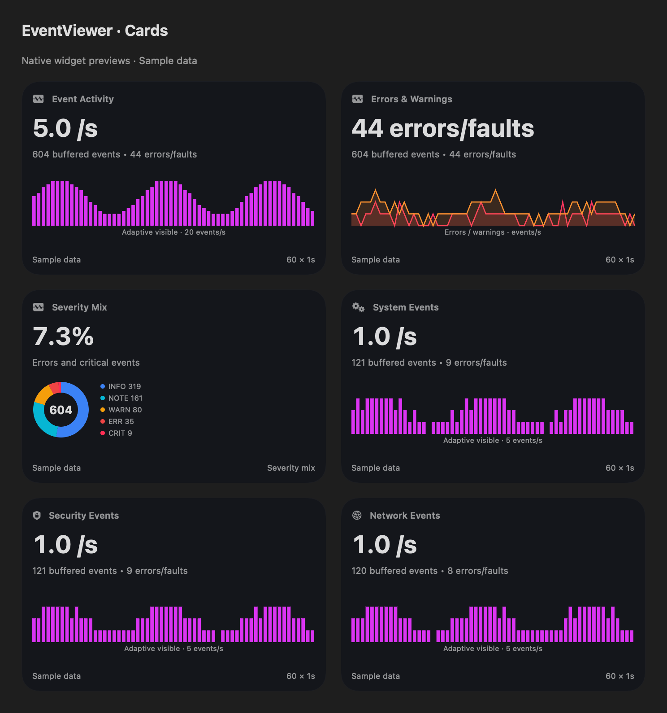

# EventViewer v1.0 — Comprehensive Feature Guide

**EventViewer** is a native Swift 6 / AppKit / SwiftUI macOS diagnostic console and desktop HUD suite developed by **Low Effort Design Studios**. It combines the familiar workflow of **Windows Event Viewer** with **macOS Unified Logging (`OSLog`)**, a **3-Column Interactive Event Flow Map**, **Diagnostic Crash Report Inspection**, and **Liquid Glass Desktop HUD Widgets**.

---

## 1. Navigation, Sortable/Resizable/Moveable Columns & Collapsible Sidebar (`⌘S`)

- **Overview**: Executive summary featuring 60-second rolling throughput waveforms (`Events/sec` and `Errors/min`), clickable severity cards (`Critical`, `Error`, `Warning`, `Notice`, `Information`), 5 channel sparkline cards, recent critical/error spotlight, and top event-producing daemons.
- **Event Logs**: Full multi-column log explorer with sortable, resizable, and drag-and-drop moveable columns (`★`, `Level`, `Date and Time`, `Channel`, `Source / Process`, `PID`, `Event ID`, `Subsystem`, `Category`, `Thread`, `Computer`, `Operational Message`), customizable **Columns** menu, channel pills, severity filter pills, time-window selector (`Last 15m`, `Last 30m`, `Last 1h`, `All Buffered`), instant search bar, bookmarking (`★`), and bottom split inspector (`General`, `Details (Windows XML)`, `Details (Unified Log JSON)`).
- **Event Flow Map**: Interactive 3-column Bezier curve topology connecting `Processes & Daemons` → `Unified Log Subsystems` → `Severity & Alert Clusters`, plus a `Subsystem Hierarchy Tree` view.
- **Crash Reports**: Resizable master-detail inspector for `~/Library/Logs/DiagnosticReports` and `/Library/Logs/DiagnosticReports` (`.ips`, `.crash`, `.spin`, `.diag`) with sortable report headers (`Time`, `Process`, `PID`, `Exception`) and symbolicated thread backtraces.
- **Custom Views**: Windows Event Viewer-style saved filter views (`Administrative Events`, `Security & TCC Audit Trail`, `Kernel, IOKit & Hardware Alerts`, `Network & DNS Anomalies`), user-created custom views, and `Bookmarked Events` with full sortable, resizable, and moveable columns.
- **Settings**: 5 segmented configuration panels (`General`, `Menu Bar`, `Widgets`, `Display`, `Behaviours`).

---

## 2. Theming, Monograms & Per-Channel Accents

- **9 Themes**: `Dark Mode`, `Light Mode`, `Brand Purple`, `Hot Pink`, `Amber Gold`, `Cyber Cyan`, `Emerald Green`, `Monochrome`, and `Follow System`.
- **Dynamic Dock & About Icon**: Automatically updates the macOS Dock icon to match your active theme and selected monogram (`EV`, `EE`, or `LE`).
- **Per-Channel Custom Colors**: Customize the accent color independently for `System`, `Application`, `Security`, `Kernel`, and `Network`.
- **Dynamic Alert Thresholds**: Configure Amber Warning and Red Critical thresholds for `Events/sec` and `Errors/min`.

---

## 3. Floating Desktop HUD Widgets & Menu Bar Designer

- **Built-in Desktop HUDs**:
  1. `All-in-One Event HUD`
  2. `Live Event Ticker HUD`
  3. `Error & Fault Monitor HUD`
  4. `Security & TCC Audit HUD`
- **Custom Modular HUD Builder**: Create custom floating HUDs locked to a specific process (e.g. `WindowServer`), channel, subsystem, or multi-source grid.
- **Menu Bar Item Designer**: Choose a preset or compose a custom sequence of tokens (`EV Badge`, `Events/sec`, `Errors/min`, `Critical Count`, `System Rate`, `Security Rate`, custom separators, and SF Symbols).

---

## 4. Auto-Updater & Zero Telemetry Capture

- **GitHub Releases Auto-Updater (`AutoUpdateManager`)**: Checks `LowEffortDigital/EventViewer` for new releases and downloads `.dmg` updates with a 3-tier fallback (`URLSession` octet-stream API download with redirect header stripping, `gh release download` fallback, and direct browser URL fallback).
- **Zero Telemetry Capture**: 100% local log inspection with zero usage telemetry, zero analytics beacons, and zero tracking.

## Optional Cards and visual widget gallery (1.3)

Settings → Custom Widgets → Widget Gallery shows six sample previews. Select a preview and Add Widget, then configure its scope, summary, graph and scale. Existing custom HUDs remain Classic; built-in HUD layouts are unchanged. Cards summarize timestamped events retained in the selected buffer, with 60 intervals at the sampling cadence. The eight graph forms include severity composition and paired error/warning rates; adaptive/fixed domains do not alter alert thresholds. An empty target never silently switches to the global stream.

