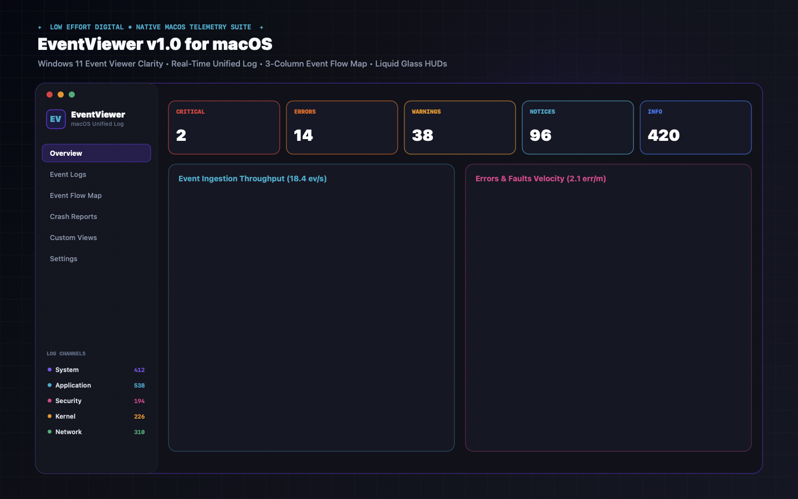
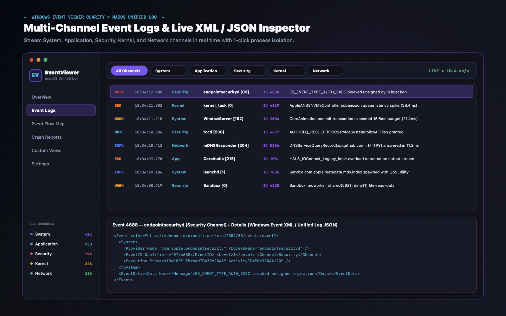
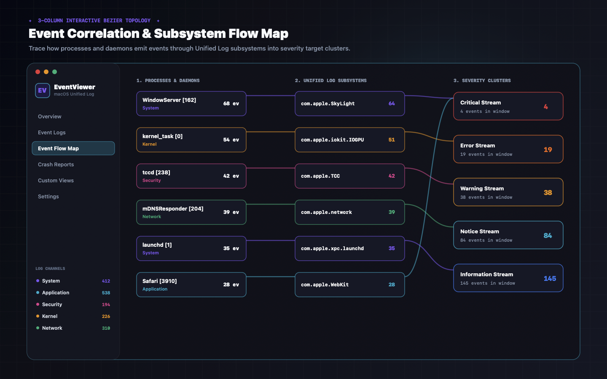
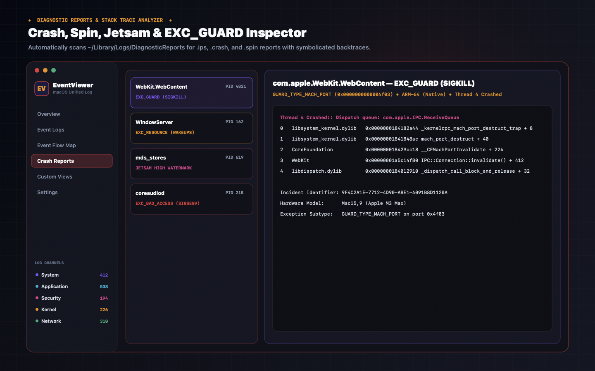
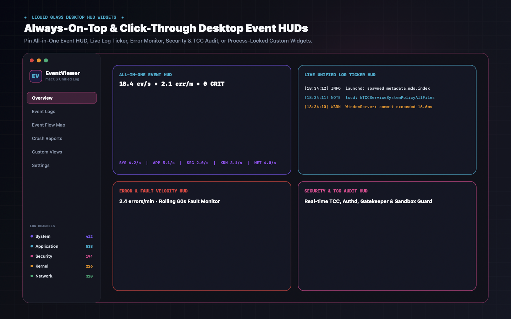
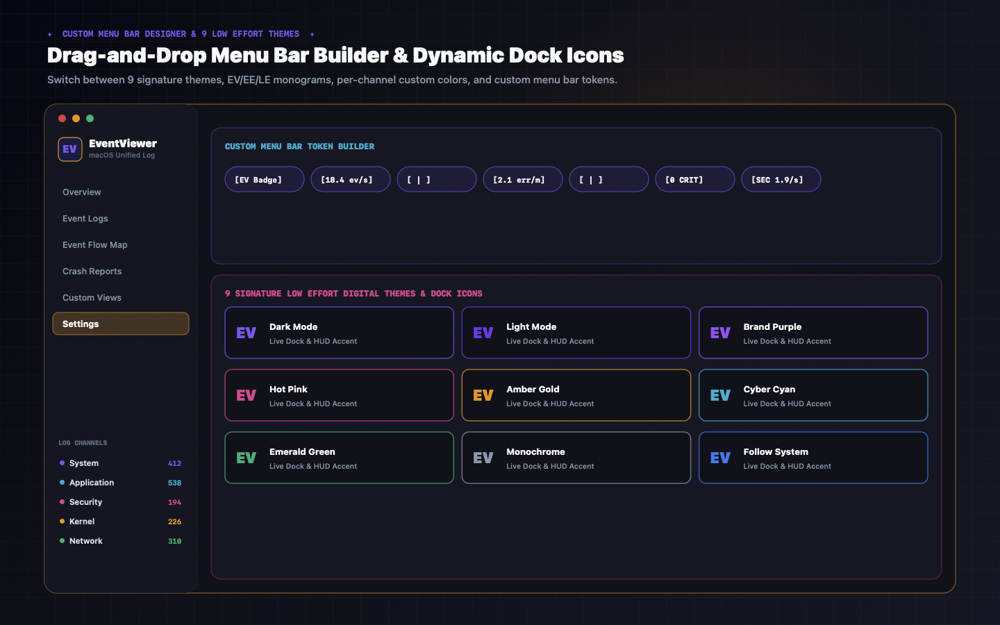

<div align="center">


# EventViewer for macOS (v1.0)

**Windows 11 Event Viewer Clarity × Native macOS Unified Logging, Interactive Event Flow Topology & Liquid Glass Desktop HUDs**

[](https://swift.org)
[](https://www.apple.com/macos)
[](LICENSE)
[](https://github.com/LowEffortDigital/EventViewer/releases/latest/download/EventViewer.dmg)



</div>

---

## Overview

**EventViewer** brings the structured channel organization, Event ID filtering, Custom Views, and XML/JSON property inspection of **Windows Event Viewer** to macOS—powered by native **macOS Unified Logging (`OSLog`)**, **Darwin/Mach system telemetry**, a **3-Column Interactive Bezier Event Correlation Flow Map**, a **Diagnostic & Crash Report Inspector**, and **Floating Liquid Glass Desktop HUD Widgets**.

Designed and engineered by **Low Effort Design Studios** as the companion diagnostic suite to [**PerfMon**](https://github.com/LowEffortDigital/PerfMon).

---

## Key Features

### 1. Multi-Channel Event Logs & Split XML / JSON Inspector
- Organizes macOS Unified Log and system telemetry into 5 familiar channels:
  - **System** (`launchd`, `WindowServer`, `runningboardd`, `powerd`, `thermalmonitord`)
  - **Application** (User apps, `AppKit`, `WebKit`, `CoreAudio`, `Spotlight`)
  - **Security** (`tccd`, `authd`, `syspolicyd`, `Sandbox`, `endpointsecurityd`)
  - **Kernel** (`kernel_task`, `IOGPUFamily`, `IONVMeFamily`, `APFS`, `memorystatus`)
  - **Network** (`mDNSResponder`, `nesessionmanager`, `symptomsd`, `trustd`)
- **Split Event Inspector**: Inspect any event in **General** property view, **Windows `<Event>` XML** view, or **macOS Unified Log JSON** view.
- **1-Click Isolation & Process HUDs**: Isolate any process or subsystem across the entire app, or pin a process-locked floating desktop HUD widget in one click.



### 2. 3-Column Interactive Event Correlation & Flow Map
- Visualizes live event propagation with smooth cubic Bezier curves across 3 columns:
  1. **Processes & Daemons** (`WindowServer`, `kernel_task`, `tccd`, `mDNSResponder`, `launchd`, etc.)
  2. **Unified Log Subsystems** (`com.apple.SkyLight`, `com.apple.iokit.IOGPUFamily`, `com.apple.TCC`, etc.)
  3. **Severity & Alert Clusters** (`Critical`, `Error`, `Warning`, `Notice`, `Information`)
- Click any process or subsystem node to isolate its active links (`Esc` to reset), or switch to the **Subsystem Hierarchy Tree**.



### 3. Crash, Hang, Jetsam & EXC_GUARD Diagnostic Inspector
- Automatically scans `~/Library/Logs/DiagnosticReports` and `/Library/Logs/DiagnosticReports` for `.ips`, `.crash`, `.spin`, and `.diag` reports.
- Displays crashed thread stack traces, exception codes, Mach guard violations, and raw `.ips` payloads.



### 4. Floating Liquid Glass Desktop HUD Widgets + Modular Builder
- **4 Built-in Desktop HUDs**:
  - **All-in-One Event HUD**
  - **Live Unified Log Ticker HUD**
  - **Error & Fault Monitor HUD**
  - **Security & TCC Audit HUD**
- **Custom Modular Widget Builder**: Create unlimited custom HUDs scoped to `Global Stream`, `Single Channel`, `Subsystem Filter`, `Process-Locked Stream`, or `Multi-Source Grid`.
- Supports **Always on Top (`.floating`)**, **Click-Through Mode**, **Opacity Slider**, and multi-monitor relative position memory (`WidgetPositionManager`).



### 5. Custom Menu Bar Designer & 9 Low Effort Digital Themes
- **9 Signature Themes**: `Dark Mode`, `Light Mode`, `Brand Purple`, `Hot Pink`, `Amber Gold`, `Cyber Cyan`, `Emerald Green`, `Monochrome`, and `Follow System` with live Dock icon switching and customizable monogram (`EV`, `EE`, `LE`).
- **Per-Channel Custom Accent Colors** & **Dynamic Amber/Red Alert Rate Thresholds**.
- **Menu Bar Token Designer**: Build your own macOS status bar item combining badges, event rates, error counts, and channel rates.
- **Built-in GitHub Auto-Updater** (`AutoUpdateManager`) & **Anonymous On-Device Runtime Telemetry** (`RuntimeTelemetryManager`).



---

## Installation & Building from Source

### Direct Download (`.dmg`)
Download the latest universal macOS disk image from GitHub Releases:
- [**Download EventViewer.dmg (v1.0)**](https://github.com/LowEffortDigital/EventViewer/releases/latest/download/EventViewer.dmg)

### Build from Source
```bash
git clone https://github.com/Facelesswhite/EventViewer.git
cd EventViewer
./Scripts/generate_icns.sh
./Scripts/build_app.sh
./Scripts/package_dmg.sh
open dist/EventViewer.app
```

### Run Unit Tests
```bash
swift test
```

---

## Documentation & Privacy
- [**Complete Feature Guide (`FEATURE_GUIDE.md`)**](FEATURE_GUIDE.md)
- [**Privacy Policy (`PRIVACY.md`)**](PRIVACY.md) — 100% local log inspection; zero log data ever leaves your Mac.
- [**MIT License (`LICENSE`)**](LICENSE)
